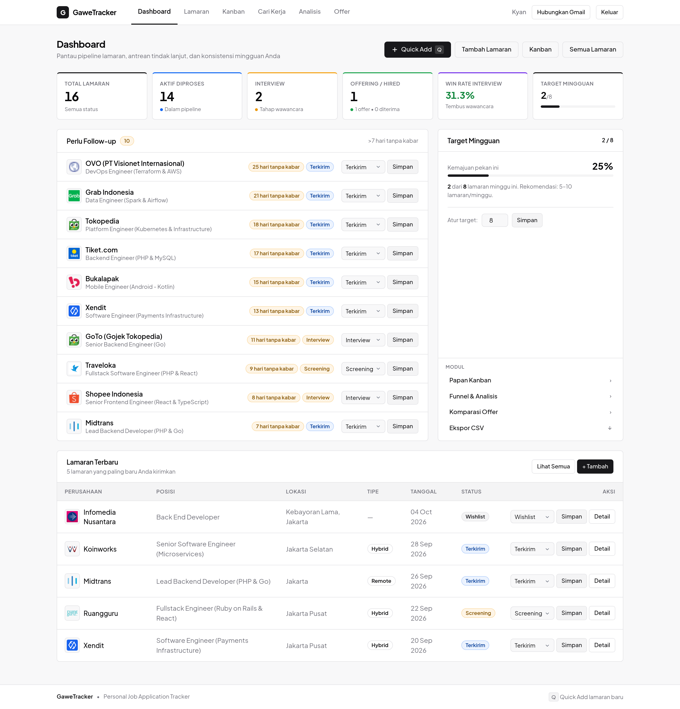
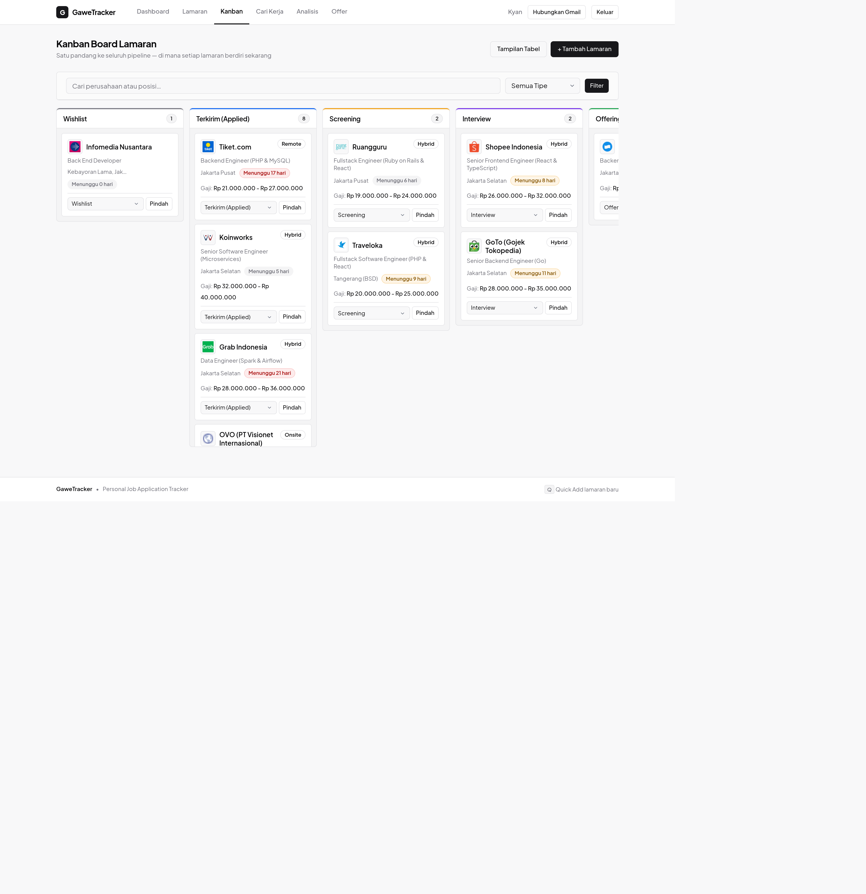
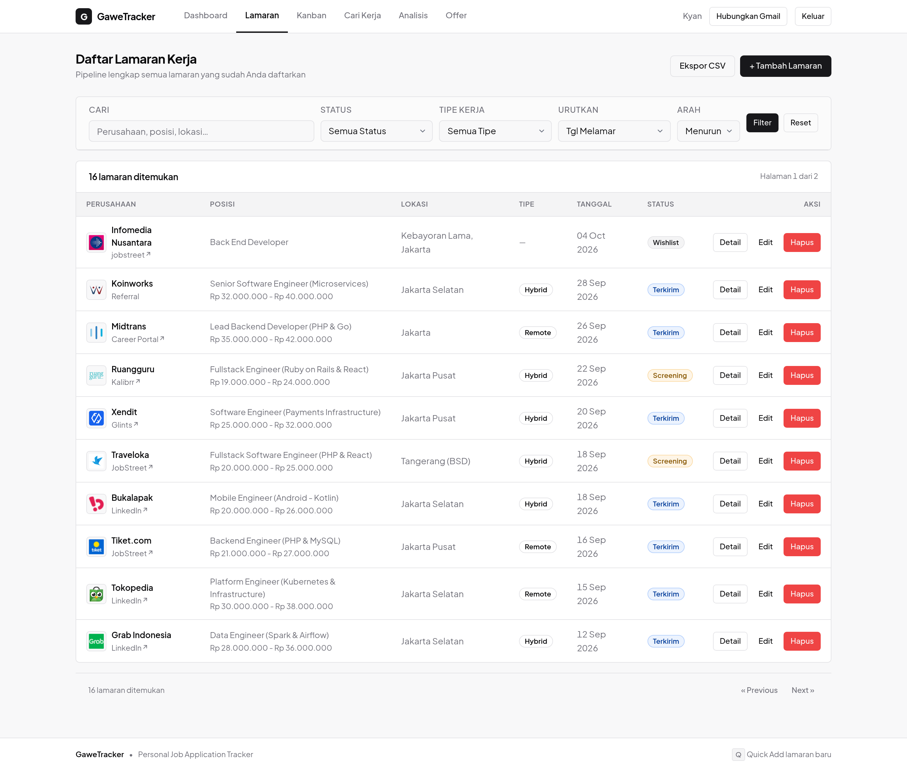
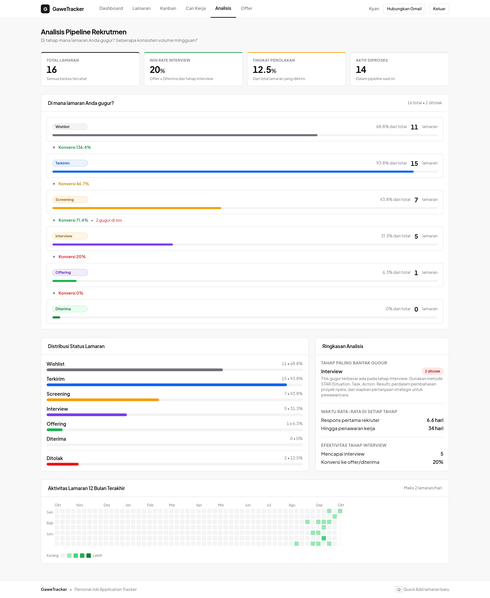
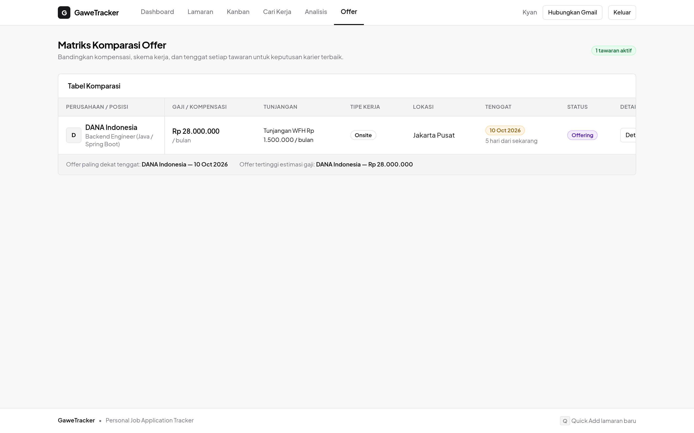

# GaweTracker

A personal job application tracker for job seekers who apply to many companies and lose track of where each application stands — one place to log applications, watch the recruitment pipeline on a Kanban board, and learn from the data over time.

🌐 **Live:** [https://gawetracker.kianlabs.my.id](https://gawetracker.kianlabs.my.id) — note: the live instance is protected by Cloudflare Access (owner only), so please use the screenshots below to see the app.

## Screenshots

| Dashboard | Kanban Board |
|---|---|
|  |  |

| Applications | Analytics |
|---|---|
|  |  |

| Offer Comparison |
|---|
|  |

Captured from a local instance seeded with realistic Indonesian tech-company data.

## Why This Exists

Kyan started applying for jobs and realized applications were scattered across emails, spreadsheets, and memory. GaweTracker was built to solve that problem: a single place to track every application, see where each one stands in the pipeline, and learn from the data over time.

## Features

- **CRUD for job applications** — company, position, location, work type, source, link, salary range, HR contact, notes
- **Pipeline stages** — wishlist → applied → screening → interview → offer → hired (plus rejected)
- **Kanban board** — visual cards grouped by stage
- **Dashboard** — total applications, follow-up reminders (>7 days without updates), weekly target progress, offer deadline alerts
- **Status timeline** — history of stage changes per application
- **Pipeline analytics** — conversion funnel, rejection breakdown by stage, time-to-response averages, weekly volume, 12-month activity heatmap
- **Offer comparison matrix** — side-by-side view of multiple offers with salary, benefits, and deadline
- **Interview prep checklist** — per-application checklist
- **Filter and search** — by company, position, status, work type; state persisted in URL
- **Company logos** — auto-resolved via Google Favicon API with initial-letter fallback
- **CSV export** — export filtered application data
- **Job discovery (Glints & JobStreet)** — search live postings from both boards inside the app and promote a posting into an application in one click (see below)
- **Email ingestion (Glints & JobStreet)** — application emails keep the pipeline in sync automatically (see below)

## Tech Stack

| Layer | Choice | Why |
|-------|--------|-----|
| Framework | Laravel 13 | Full-featured PHP framework, active ecosystem |
| Frontend | Blade templates | Server-rendered HTML, no build step complexity |
| CSS | Pure CSS (public/css/shadcn.css) | No Vite/Node toolchain — reduces setup for a solo project |
| Database | MySQL | Standard relational DB, works with Laravel migrations |
| Auth | Single-user login | v1 scope is personal use only, no public registration |
| Testing | PHPUnit | Laravel's default test framework |

## Local Setup

1. Clone the repository
   ```bash
   git clone https://github.com/kianlabs/gawetracker.git
   cd gawetracker
   ```

2. Copy environment file
   ```bash
   cp .env.example .env
   ```

3. Configure database in `.env`
   ```
   DB_CONNECTION=mysql
   DB_HOST=127.0.0.1
   DB_PORT=3306
   DB_DATABASE=gawetracker
   DB_USERNAME=your_username
   DB_PASSWORD=your_password
   ```

4. Install dependencies
   ```bash
   composer install
   ```

5. Generate application key
   ```bash
   php artisan key:generate
   ```

6. Run migrations with seed data
   ```bash
   php artisan migrate --seed
   ```

7. Start development server
   ```bash
   php artisan serve
   ```

8. Open http://localhost:8000 in your browser

Default login credentials (from UserSeeder):
- Email: kyan@gawetracker.test
- Password: password

Override via `ADMIN_EMAIL`, `ADMIN_NAME`, `ADMIN_PASSWORD` in `.env` *before* running `php artisan migrate --seed`. The seeder uses `firstOrCreate`, so these only apply on a fresh seed; editing them later does not update an existing user.

⚠️ **Change the default password immediately after first login in production.**

## Deployment

GaweTracker is Laravel + MySQL. Deployment paths provided:

- **Cloudflare Tunnel** (this deployment) — container runs locally, exposed via
  `cloudflared` at **https://gawetracker.kianlabs.my.id**, protected by
  **Cloudflare Access** (email allow-list, owner only).
- **Fly.io** (container) — `fly.toml` + `Dockerfile` + `deploy/fly/README.md`
- **Oracle Cloud Always Free / plain Ubuntu VPS** — `deploy/oracle/` (provision,
  release, keepalive, backup scripts + crontab)

For Railway, Fly.io, or a custom VPS, see [DEPLOYMENT.md](DEPLOYMENT.md).

## Job discovery (Glints & JobStreet)

GaweTracker can pull live job postings straight from **Glints** and **JobStreet** so you can browse openings and promote the interesting ones into your pipeline without leaving the app. Open **Cari Kerja** (`/discovery`), type a keyword (for example `backend developer` or `data analyst`) and pick how many results to pull per board; postings are deduplicated and refreshed idempotently.

From the CLI:

```bash
php artisan jobs:discover "backend developer" --limit=30
```

How it works: both boards implement the same `JobSource` contract, so each one normalises its own response shape into a `DiscoveredJob` before the service sees it:

- **`GlintsSource`** — Glints' own no-auth GraphQL endpoint (`/api/v2-alc/graphql`, operation `searchJobs`). Requests send browser-like headers or Glints' firewall returns HTML; pagination is by `limit`/`offset`.
- **`JobstreetSource`** — the SEEK v5 JSON API (`id.jobstreet.com/api/jobsearch/v5/search`, `siteKey=ID-Main`). The same platform powers Jobstreet, SEEK and JobsDB, so the endpoint/site key are overridable per market.
- **`JobDiscoveryService`** — runs every source, normalises results into `JobPosting` rows, and persists them idempotently on `(source, external_id)`. One board failing never aborts the run; the failure is reported as a warning instead.

> Both endpoints are unofficial and reverse-engineered, so their schemas may drift. Parsing is deliberately defensive: a malformed item is skipped rather than aborting the whole search.

Configuration is optional — both boards have sensible defaults and can be repointed per market through environment variables:

```dotenv
GLINTS_ENDPOINT=https://glints.com/api/v2-alc/graphql
GLINTS_COUNTRY=ID
JOBSTREET_ENDPOINT=https://id.jobstreet.com/api/jobsearch/v5/search
JOBSTREET_SITE_KEY=ID-Main
```

## Email ingestion (JobStreet & Glints)

GaweTracker can read your JobStreet/Glints application emails and keep your pipeline in sync automatically — confirmations create applications, and later emails (interview, offer, rejection) update their status.

```bash
# Parse and inspect a folder of .eml files without touching the database
php artisan emails:import storage/app/emails --dry-run

# Ingest them for real
php artisan emails:import storage/app/emails

# Pull directly from Gmail (read-only)
php artisan emails:import --gmail --max=100
```

Gmail is connected via a standard OAuth2 authorization-code flow (`access_type=offline`), so a refresh token is stored and the 1-hour access token is renewed automatically. Tokens are **encrypted at rest**; the refresh token is never stored in plaintext. Setup: create a Google Cloud project, enable the Gmail API, add an OAuth client with redirect URI `{APP_URL}/gmail/callback`, and put `GOOGLE_CLIENT_ID` / `GOOGLE_CLIENT_SECRET` / `GOOGLE_REDIRECT_URI` in `.env`.

Design notes:
- **Idempotent** — every email's `Message-ID` is recorded in `ingested_emails`, so re-running never double-counts.
- **Forward-only** — a status is only applied when it moves an application *forward*; a stale email can't downgrade an advanced one, and terminal (`hired`/`rejected`) states are never overwritten.
- **Digests ignored** — job-alert emails ("new jobs for you") never create applications.

## Tests

183 tests, 936 assertions — run the full suite:

```bash
php artisan test
```

Run specific test suites:

```bash
php artisan test --testsuite=Feature
php artisan test --testsuite=Unit
```

## Project Structure

```
app/
├── Http/Controllers/     # Request handlers (AuthController, JobApplicationController, AnalyticsController, etc.)
├── Models/               # Eloquent models (JobApplication, StatusHistory, OfferDetail, InterviewChecklist)

resources/
├── views/                # Blade templates (dashboard, kanban, analytics, offers, forms)

public/
├── css/shadcn.css        # Pure CSS styling (no build step)

tests/
├── Feature/              # Full-stack integration tests
├── Unit/                 # Isolated unit tests

database/
├── migrations/           # Schema definitions
├── seeders/              # Realistic Indonesian tech company seed data
```

## What I Learned

- **A solo project stays shippable when the stack stays boring.** Laravel + Blade + pure CSS (no Vite/Node build step) meant the whole app could be set up and deployed by one person — complexity has to earn its place.
- **Unofficial APIs demand defensive design.** Both job boards are reverse-engineered, so a shared `JobSource` contract, per-source normalisation, and idempotent persistence on `(source, external_id)` keep one board's schema drift from breaking the other.
- **State machines should only move forward.** Email ingestion never downgrades a status and never overwrites terminal states — a stale email arriving late must not rewrite history.
- **Seed data is a product decision.** Realistic Indonesian tech-company seed data is what makes the dashboard, Kanban, and analytics screenshots believable instead of empty.
- **Security is in the defaults.** Single-user login, encrypted Gmail tokens at rest, and an explicit warning to change the seeded password keep a personal tool from becoming a liability.

## License

MIT
